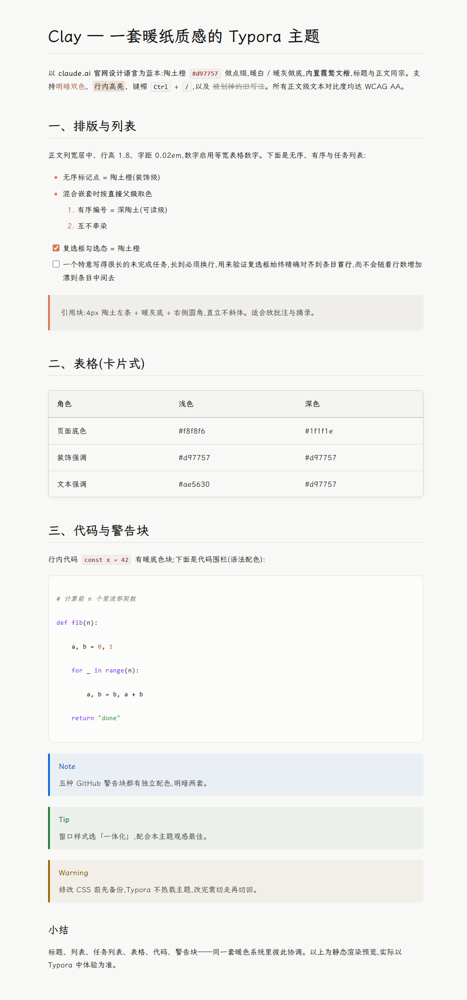
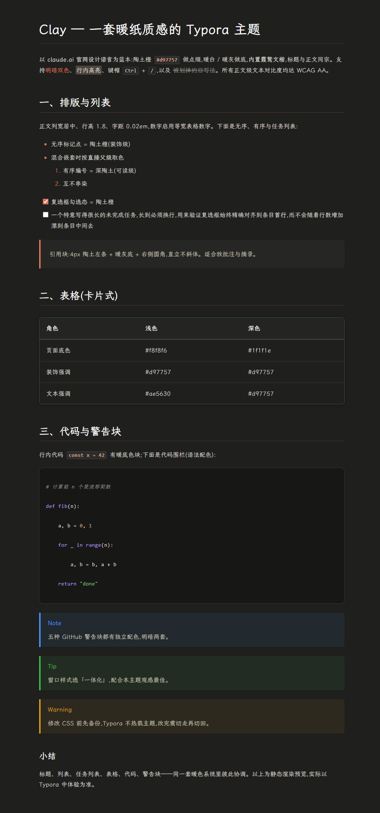

# Clay — Typora 主题(明 / 暗)

> A warm, paper-textured Typora theme (light + dark), inspired by the claude.ai design language.

[](./LICENSE)
[](https://linux.do)

一对以 **claude.ai 官网设计语言**为蓝本的 Typora 主题:暖白纸感的浅色 `clay` 与暖灰深底的深色 `clay-dark`。配色对齐官网实测色板(陶土橙 Clay `#d97757` + 暖灰中性色),标题与正文统一走**随主题打包的霞鹜文楷 LXGW WenKai**,所有功能区块明暗**结构完全对称**(188 对规则逐条配对、零单边差异)。

- 适配环境:**Typora 1.13.4 / Windows**(1.5+ 版本的语法块均有覆盖;含 macOS seamless 兼容规则)
- **内置中文字体**:附带霞鹜文楷 Regular / Medium / Mono 三款 woff2,明暗两版一致,无需另行安装字体
- 零网络依赖:字体为本地自托管,不发起任何在线请求,离线 / 弱网 / 大陆网络环境下无渲染阻塞
- 中英混排优化:文楷统一覆盖中英文与标点;未命中时按宋体系 / 苹方 / 雅黑 / 更纱黑体逐级回退

---

## 预览

**浅色 · Clay**



**深色 · Clay Dark**



> 上图为主题渲染效果预览;实际以 Typora 中体验为准(建议配合「一体化」窗口样式)。

---

## 一、安装

### 文件构成

| 文件 / 目录 | 说明 |
|---|---|
| `clay.css` | 浅色主题 |
| `clay-dark.css` | 深色主题(与浅色逐区块对称) |
| `clay/` | 字体目录:霞鹜文楷 3 款 woff2 + `OFL.txt`。**两个 css 都依赖它**,需一起复制 |

### 主题目录

把两个 `.css` **和 `clay/` 目录**一起复制到 Typora 的主题目录:

| 平台 | 路径 |
|---|---|
| Windows | `%APPDATA%\Typora\themes\` |
| macOS | `~/Library/Application Support/abnerworks.Typora/themes/` |
| Linux | `~/.config/Typora/themes/` |

> 在 Typora → 文件 → 偏好设置 → 外观 → **打开主题文件夹**,可直接跳到该目录。

复制完成后,主题目录下应该是这样:

```
themes/
├── clay.css
├── clay-dark.css
└── clay/
    ├── LXGWWenKai-Regular.woff2
    ├── LXGWWenKai-Medium.woff2
    ├── LXGWWenKaiMono-Regular.woff2
    └── OFL.txt
```

> [!IMPORTANT]
> `clay/` 必须与两个 `.css` **同级**——css 里的 `@font-face` 按 `clay/xxx.woff2` 相对寻址。只复制 css 不复制目录,主题依然能用,但会静默回退到系统字体,失去文楷观感。

### 启用 / 更新

- **启用**:Typora → 文件 → 偏好设置 → 外观 → 主题,选择 `Clay` 或 `Clay Dark`
- **窗口样式选「一体化」**(强烈建议):偏好设置 → 外观 → 窗口样式 → **一体化**,标题栏 / 侧栏 / 正文同底融为一体,是本主题的推荐形态;切换后需**重启 Typora** 生效
- **修改 CSS 后生效**:切走主题再切回,或重启 Typora(Typora 不热载主题)
- **改样式前先备份**:编辑前复制一份 `.css`(或用 git 版本管理),便于回滚

> [!TIP]
> 本主题是按**一体化(Seamless)窗口样式**调校的——侧栏、标题栏、正文共用暖色底,窗框细线也随主题走。选「经典」样式同样能用,但一体化观感明显更完整。

---

## 二、设计语言

### 色板(两级强调色体系)

核心原则:**Clay 橙 `#d97757` 只做装饰**(引用条、光标、复选框、悬停底色、标记点),**正文级可读文本一律用加深的 `--accent-text-color`**,保证 WCAG AA(≥4.5:1)。

| 角色 | 浅色 | 深色 |
|---|---|---|
| 页面底色 | `#f8f8f6` 暖白 | `#1f1f1e` 暖黑 |
| 正文 | `#121212` | `#d5d4cb` |
| 装饰强调 `--accent-color` | `#d97757` | `#d97757` |
| 文本强调 `--accent-text-color` | `#ae5630`(4.73:1) | `#d97757`(深底上 4.7:1,可直接作文本) |
| 淡橙底上的文本(侧栏激活 / 标签 / 脚注) | `#9a4a28`(5.35:1) | `#d97757` |
| 引用底 / 侧栏底 | `#efeeeb` | `#262625` / `#171716` |
| Mermaid 面板底 | `#ffffff` | `#262625` |

### 字体栈(内置霞鹜文楷,全部本地,无网络请求)

栈首是随主题打包的 **霞鹜文楷 LXGW WenKai**(`clay/` 内的 woff2),明暗两版完全一致:

| 用途 | 栈 |
|---|---|
| 标题 `--font-heading` | **LXGW WenKai** → Anthropic Serif → Söhne Serif → ui-serif → Georgia → 宋体 / 思源宋体 |
| 正文 `--font-body` | **LXGW WenKai** → Anthropic Sans → Inter → Söhne → Segoe UI → 苹方 / 微软雅黑 |
| 等宽 `--font-mono` | Anthropic Mono → Fira Code → JetBrains Mono → Consolas → **LXGW WenKai Mono** → 更纱黑体 Mono SC |
| 界面 `--font-ui` | 同正文系(不含文楷),用于菜单 / 对话框 / 表单控件 |

字重按真实字形绑定:`Regular` 绑 `100–450`、`Medium` 绑 `500–900`,所以**加粗与标题用的是真 Medium 字形,而非浏览器伪粗体**,不糊边;正文加粗在 Medium 之上再叠 0.25px 同色细描边(文楷两档字重差距偏小,只换字形不够醒目)。等宽栈把文楷 Mono 放在编程字体之后——装了 Fira Code / JetBrains Mono 的机器仍优先用它们渲染英文代码,文楷 Mono 负责兜底代码块里的中文,保证对齐代码网格。

> 不想要内置字体:把 `--font-heading` / `--font-body` 栈首的 `"LXGW WenKai", ` 删掉即可,其余回退栈原样可用。

### 版式

- 正文列宽 820px 居中(≥1400px 宽屏放宽到 880px;窄窗 ≤768px 收边距),行高 1.8,字距 0.02em(配合文楷偏宽的字面,中文阅读更松弛)
- 数字启用等宽表格数字(`tabular-nums`),表格 / 数据列天然对齐
- 文档首元素顶距收窄(以标题开头时不留大空白)

---

## 三、内容渲染功能

### 标题
- h1 `2.2em / 700` + 下边框;h2 `1.7em` + **陶土色半透明下划线**(浅 22% / 深 28%,`color-mix` 渐进增强);h3–h5 递减 600;h6 小型大写 + 弱化灰,当"眉题"用
- 标题内联代码不放大缩小(`font-size: inherit`)

### 列表
- 无序列表标记点 = Clay 橙(装饰);**有序列表编号 = 深陶土**(可读级);混合嵌套时按**直接父级**取色,互不串染
- **任务列表**:复选框绝对定位、精确对齐条目**首行**(长换行 / 多段 / 粗体连内联代码均不漂移,像素级 delta=0 验证);勾选态陶土橙(`accent-color`);悬停轻微放大不推挤文本
- 列表内图片:块级左对齐、带上下间距,不与文字挤在一行

### 引用块
Clay 4px 左条 + 暖灰底 + 右侧圆角,**直立不斜体**;嵌套引用右内距收平。

### 表格(卡片式)
圆角 + 浅阴影 + 外边框;表头着色 + 2px 强分隔;行悬停淡橙底;末行无底线。

### 内联代码 / 高亮 / 键帽
- `code`:暖底色块 + 细边框 + 红棕字(600 权重),跨行折行时两端圆角均保留(`box-decoration-break: clone`)
- `==高亮==`:暖棕半透明底(非刺眼默认黄),同样支持跨行
- `<kbd>`:键帽样式(双倍下边框模拟按键立体感);`<abbr>` 虚线底 + help 光标
- **加粗** `**text**`:真 Medium 字形 + 0.25px 同色细描边,与 Regular 正文拉开明确的分量差

### 代码围栏(编辑态 CodeMirror)
- Mac 风格圆角卡片,完整语法配色:关键字紫 / 字符串绿 / 数字橙 / 标签属性蓝 / 注释灰斜体,明暗两套独立调色
- 光标 2px 陶土色;选区用主题选择色;开启行号时行号槽透明底 + 右分隔线
- 围栏内代码不继承内联代码的边框 / 底色 / 加粗(导出 HTML 也不串色)

### 源代码模式(`Ctrl + /`)
- 全区等宽字体(含代码 span / 表格行等 Typora 默认强制通用等宽的 token,统一为主题等宽栈,表格竖线对齐)
- 内容居中成列(820px,与正文一致)
- Markdown token 重着色:标题行陶土、注释灰、字符串绿、数字橙、链接 / HTML 标签蓝(修复 Typora 默认色在深底上 2.5:1 不可读的问题)
- 光标陶土色;当前行淡色高亮

### 其他块级元素
- **GitHub 警告块** `> [!NOTE/TIP/IMPORTANT/WARNING/CAUTION]`:五色左条 + 同色调淡底,明暗两套(深色用 GitHub Dark 色值)
- **YAML Front Matter**:虚线边框面板 + 等宽字体
- **数学公式**:行内公式底色块;公式块工具提示浮层阴影 + 圆角(含官方同款定位修正)
- **Mermaid 图表**:圆角边框面板;配色随主题走——浅色 `--mermaid-theme: default`、深色 `dark`(Typora 渲染时读取该变量),深色下面板同步换成暖灰暗底 `#262625`,不再嵌一块白板
- **脚注**:上标做成暖底小徽章;脚注区顶部分隔线
- `~~删除线~~` 弱化灰;`<u>` / `<ins>` 陶土色下划线;`#标签` 暖底圆角小片
- 图片:块级居中 + 圆角 + 浮起阴影,悬停轻微放大;上下间距 0.9em,**紧跟标题的图片再收窄到 0.4em**(配图不再与标题脱节);`[TOC]` 目录卡片化

---

## 四、编辑器体验

- **光标**(正文 / 源码 / 围栏)统一陶土色
- **选区**:暖橙底;`Ctrl+F` 搜索命中:更深暖橙底(选中命中单独一档)
- **专注模式(F8)**:非焦点段落整体压暗为弱化灰——**链接 / 内联代码 / 粗体 / 高亮一并压暗**不残留亮色;代码围栏与源码模式同步压暗非活动行;图片 / SVG 降透明度;引用条同步减淡;紧凑列表有防"自灰"保护
- **打字机 / 滚动**:自定义细滚动条(悬停加深),不突兀
- **侧栏**:文件树 / 文件列表 / 大纲激活项 = 淡橙底 + 3px 陶土左条 + 加深文字;悬停淡橙底;全局搜索结果激活行同色系(`--active-file-text-color`)
- **快速打开(Ctrl+P)**:圆角浮层 + 激活行同侧栏色系
- **搜索替换面板**:主题化输入框;选项按钮激活态陶土底白字
- **输入框聚焦边框**(搜索框 / 对话框输入等)= 陶土色(压掉 Typora 默认的 Bootstrap 蓝,`--primary-color`)
- **菜单 / 对话框**:起始页大菜单、右键菜单、下拉菜单、偏好设置、模态框全部主题化;主按钮陶土底白字(官网 CTA 同款),悬停加深
- **窗框细线** `--window-border`:侧栏页签 / 文件行分隔 / 下拉分割线等按主题边框色走(深色下不再露浅色发丝线)
- **起始页 / 窗口标题栏**:起始页「菜单」标题与返回按钮走主题文字色(Typora 底座硬编码的白字在暖白侧栏上不可读);最小化 / 最大化 / 关闭按钮压回 24px 标题栏高度,下沿不再多出一截台阶,悬停底色随主题(深色下不闪浅灰)
- 表格编辑工具条 / 底部字数统计 / 源码切换按钮激活态 / 工具提示(深底白字)均已主题化
- 编辑期元 token(标题 `{#id}` 属性、HTML 注释)弱化显示

---

## 五、导出与打印

- `@media print`:正文缩至 13px;表格 / 代码块 / 引用 / 图片 / 警告块**不跨页截断**;标题后不孤立分页;段落孤行寡行控制(orphans/widows 3)
- 导出 PDF / 打印时自动去掉图片、表格、代码块阴影(纸面干净)
- 无在线字体引用 → 导出不会卡在网络请求
- 深色主题导出 PDF 保持深色(与 Typora 官方 night 主题行为一致,刻意不强制翻白)

---

## 六、对比度与可读性承诺

- 所有**正文级**文本 token ≥ 4.5:1(AA):正文、链接、标题、引用、脚注、标签、侧栏激活文字等均实测达标
- 专注模式压暗色 = 弱化灰(浅 `#7b7974` / 深 `#97958c`),**同时定义了 Typora 内部的 `--blur-text-color`**,连 Typora 基础样式自己的压暗规则也走主题灰(修复深色下默认 `#C8C8C8` "越压越亮"的问题)
- 已知惯例值(刻意保留):语法高亮字符串 / 数字在浅色下 3.7–3.9:1(通行的代码高亮密度取舍)、h6 眉题 4.09:1(官网原生 token)、主按钮白字压陶土底(官网同款)

---

## 七、自定义入口(改 `:root` 变量即可)

| 想改什么 | 动哪个变量 |
|---|---|
| 换强调色 | `--accent-color`(装饰)+ `--accent-text-color`(文本级,注意对比度) |
| 换字体 / 关掉内置文楷 | `--font-heading` / `--font-body` / `--font-mono`(删掉栈首的 `"LXGW WenKai", ` 即回到系统字体) |
| 列宽 | `#write { max-width }`(两处:默认 820 与宽屏 880)|
| 代码高亮配色 | `--code-keyword/string/number/symbol/muted-color` |
| 表格 / 引用底色 | `--table-*` / `--quote-*` |
| 侧栏激活色系 | `--active-file-bg/border/text-color` |
| Mermaid 配色 | `--mermaid-theme`(`default` / `dark` / `forest` / `neutral` / `base`,Typora 渲染时读取) |

明暗两文件区块顺序完全一致,改动请**成对**进行以维持对称。

---

## 八、质量基线

开发中经过五轮审查:静态分析(括号 / 变量 / 选择器配对)、真实浏览器渲染(Playwright 计算样式 + 截图)、**与 Typora 真实 base.css 同层加载的级联回归测试**、WCAG 对比度实算、对抗式代理复查。当前状态:两文件 194/194 括号平衡、188 对规则零单边零属性差、零悬空变量。2026-10 针对三个 issue 的修复(深色 Mermaid、标题栏按钮台阶、起始页菜单白字、加粗分量)另以 Typora 真实 window.css / megamenu.css / bootstrap 与官方 mermaid 11 同层复现,做了修复前后的像素级对照。

日常自检:随手用一篇含标题 / 列表 / 任务列表 / 表格 / 代码块 / 引用 / 警告块 / 公式的 Markdown,在明暗两主题下逐项对照(重点看:源码模式配色、对话框无蓝色残留、深色窗框、复选框首行对齐、专注模式压暗方向)。

---

## 九、致谢

感谢 [**LINUX DO**](https://linux.do) 社区的交流与反馈。

> LINUX DO 是一个真诚、友善、团结、专业的技术社区。*Where possible begins.*

---

## License

主题样式(`clay.css` / `clay-dark.css` / 文档):[MIT](./LICENSE)

**内置字体单独授权**:`clay/` 下的霞鹜文楷 LXGW WenKai(Regular / Medium / Mono)版权归 [LXGW](https://github.com/lxgw/LxgwWenKai),以 **SIL Open Font License 1.1** 授权,完整条款见 [`clay/OFL.txt`](./clay/OFL.txt)。本仓库仅以 woff2 形式随主题分发、供 `@font-face` 渲染,未作为可安装的桌面字体提供,符合该字体 OFL 中的附加许可条款。字体本身不适用 MIT。霞鹜文楷衍生自 [Klee One](https://github.com/fontworks-fonts/Klee)(FONTWORKS Inc.,同为 OFL 1.1)。

本主题在视觉上参考了 [claude.ai](https://claude.ai) 的公开设计语言(配色 / 版式),与 Anthropic 无隶属或背书关系。"Claude" 为 Anthropic 的商标,此处仅作事实性引用。

---

*主题文件:`clay.css`、`clay-dark.css` 与 `clay/` 字体目录(三者一并放入 Typora 主题目录) · 基于 Typora 1.13.4 验证 · 2026-10*
